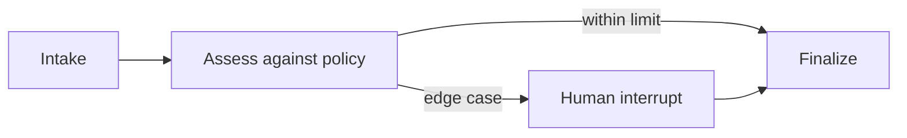

# Intelligent Claims Agent

An auditable claims intake workflow built with LangGraph. The graph applies deterministic demo policy rules and pauses on a human interrupt whenever a claim needs judgment. A reviewer resumes the same checkpointed thread with a recorded decision.

## Workflow



## Run

```bash
python -m venv .venv && source .venv/bin/activate
pip install -e '.[test]'
uvicorn claims_agent.app:app --reload
```

Submit a claim to `POST /claims`; high-value or invalid claims return `awaiting_human_review`. Resume with `POST /claims/{claim_id}/review` and `{ "approved": true, "reviewer": "reviewer@example.test", "note": "receipt verified" }`.

## Safety and scope

- Demo limits are fictional and do not represent an insurer's coverage rules.
- The model does not decide payment: business rules route edge cases to a human.
- Approval and reviewer identity are recorded in the workflow state.
- Production deployment needs authenticated reviewer identity, durable encrypted checkpoint storage, authorization checks, retention controls, and idempotent event delivery.
- LangGraph interrupt and resume are the core agent orchestration skill shown here; no external model is required for the deterministic demonstration.

## Tests

`pytest -q` exercises policy boundaries and ensures invalid claims never auto-approve.
